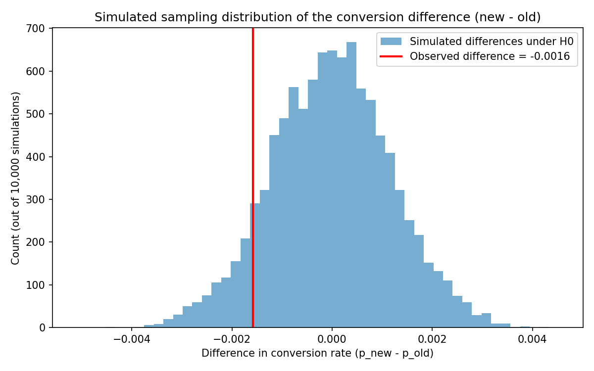

# A/B Test Analysis: E-Commerce Landing Page

Did a new landing page convert more users than the old one? This project analyzes an e-commerce A/B test with a simulation, a z-test and logistic regression, and recommends whether to implement the new page, keep the old one, or extend the experiment.

**Recommendation: keep the old page.** The new page converted slightly less than the old page, and the difference is not statistically significant in any of the three tests.

## Key results

| Metric | Value |
|---|---|
| Rows in raw data | 294,478 |
| Mismatched rows removed (group and page do not match) | 3,893 |
| Unique users after cleaning (1 duplicate user removed) | 290,584 |
| Overall conversion rate | 11.96% |
| Control (old page) conversion rate | 12.04% |
| Treatment (new page) conversion rate | 11.88% |
| Observed difference (new - old) | -0.158 percentage points |
| p-value, simulation (10,000 draws, seed 42) | 0.908 |
| z-score, proportions z-test | -1.31 |
| p-value, proportions z-test (one-sided) | 0.905 |
| p-value of the page effect, logistic regression | 0.190 |

At the 0.05 significance level we fail to reject the null hypothesis. Country (US, UK, CA) and the page x country interaction were also not significant.



## Method

1. **Cleaning:** removed rows where `group` and `landing_page` do not match (3,893 rows) and one duplicated user.
2. **Exploration:** conversion rates by group.
3. **Hypothesis test:** H0: p_new - p_old <= 0. Simulated the sampling distribution under H0 (both groups at the pooled conversion rate, 10,000 draws), and confirmed with the `statsmodels` proportions z-test.
4. **Logistic regression:** page type alone, then with country, then with page x country interaction.

## Repository structure

```
.
├── README.md
├── requirements.txt
├── results_summary.csv          # the key results table, generated by the notebook
├── data/
│   ├── ab_data.csv              # 294,478 rows: user_id, timestamp, group, landing_page, converted
│   └── countries.csv            # user country (US, UK, CA)
├── notebooks/
│   ├── AB_Test_Analysis.ipynb   # full analysis
│   └── AB_Test_Analysis.html    # exported report (no setup needed to read it)
└── images/
    ├── 01_simulated_difference_histogram.png
    ├── data_preview_with_ab_page.png
    ├── logistic_regression_interaction_summary.png
    └── original_screenshots/    # screenshots from the first version of the project
```

## How to run

```bash
pip install -r requirements.txt
cd notebooks
jupyter notebook AB_Test_Analysis.ipynb
```

The notebook reads the data from `../data/` and saves its chart to `../images/`. A fixed random seed makes the simulation reproducible.

## Tools

Python, pandas, NumPy, matplotlib, statsmodels, Jupyter Notebook.

## Notes

- The original screenshots in `images/original_screenshots/` come from an earlier version of the notebook, where the simulation resampled each group from its own data. The current version simulates both groups from the pooled rate, as the null hypothesis requires. The conclusion did not change.
- Dataset and project brief come from the Udacity Data Analyst program.
